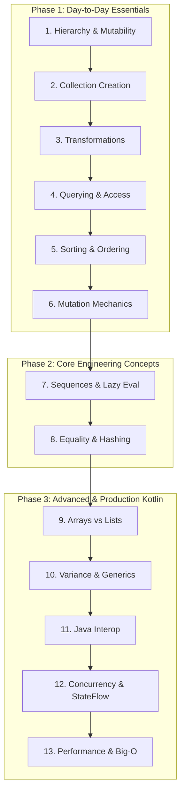
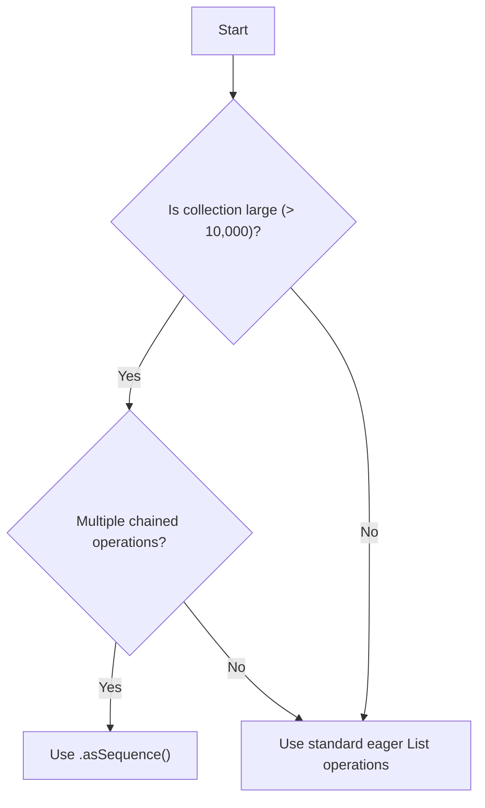

# Kotlin Collections Masterclass: Step-by-Step Learning Plan

> Designed for Kotlin developers coming from JavaScript/TypeScript or general OOP background. This structured curriculum guides you from essential daily operations to advanced performance tuning, generics, and concurrency.

---

## Overview & Progression Strategy



---

## Phase 1: Essential Day-to-Day Collections (Modules 1–6)

---

### Module 1: Core Types & Hierarchy

#### Objectives
- Understand the interface hierarchy: `Iterable` $\rightarrow$ `Collection` $\rightarrow$ `List` / `Set` (`Map` is separate).
- Distinguish between **read-only interfaces** (`List<T>`) vs **mutable interfaces** (`MutableList<T>`) vs **truly immutable collections** (`kotlinx.collections.immutable`).
- Learn default underlying implementations: `listOf()` $\rightarrow$ `ArrayList`, `setOf()` $\rightarrow$ `LinkedHashSet`, `mapOf()` $\rightarrow$ `LinkedHashMap`.

#### Key Concepts & Snippets
```kotlin
// Read-only interface (no add/remove methods)
val readOnly: List<String> = listOf("A", "B")

// Mutable interface (has add/remove/clear)
val mutable: MutableList<String> = mutableListOf("A", "B")

// Key distinction: read-only != immutable
val listRef: List<String> = mutable // View onto mutable list!
```

#### JS vs Kotlin Mental Model
| Feature | JavaScript / TypeScript | Kotlin |
| :--- | :--- | :--- |
| **Read-only array/list** | `readonly string[]` (TS compile check) | `List<String>` (Interface without mutation methods) |
| **Map key-value pairs** | `Object.entries()` or `[key, val]` tuples | `Pair(k, v)`, `k to v`, `Map.Entry<K, V>` |
| **Set ordering** | `Set` preserves insertion order | `setOf()` creates `LinkedHashSet` (preserves insertion order) |

#### Practice Exercise
Write a function that accepts a `List<Int>` (read-only view) and demonstrates that modifying the underlying `MutableList` affects the read-only view.

---

### Module 2: Creating Collections & Ranges

#### Objectives
- Use standard factory functions: `listOf()`, `mutableListOf()`, `emptyList()`, `listOfNotNull()`.
- Master builder functions: `buildList { }`, `buildMap { }`.
- Master generator functions: `List(size) { index -> ... }`.
- Work with ranges: `1..10`, `until`, `downTo`, `step`.

#### Key Concepts & Snippets
```kotlin
// 1. Safe list creation omitting nulls
val validUsers = listOfNotNull("Alice", null, "Bob") // ["Alice", "Bob"]

// 2. Builder pattern (mutable inside block, exposes read-only outside)
val numbers = buildList {
    add(1)
    if (someCondition) add(2)
}

// 3. Generator function
val squares = List(5) { it * it } // [0, 1, 4, 9, 16]

// 4. Ranges
val range1 = 1..10        // 1 to 10 inclusive
val range2 = 0 until 10   // 0 to 9 (exclusive upper bound)
val range3 = 10 downTo 1 step 2 // 10, 8, 6, 4, 2
```

#### Practice Exercise
Create a list of 10 even numbers using `List(10) { ... }`, filter out values using a range condition, and build a map mapping index to squared value using `buildMap { }`.

---

### Module 3: Transformations (Daily Bread)

#### Objectives
- Master element mapping: `map`, `mapIndexed`, `mapNotNull`, `flatMap`, `flatten`.
- Master filtering: `filter`, `filterNot`, `filterIsInstance<T>()`, `partition`.
- Convert lists to maps: `associate`, `associateBy`, `associateWith`.
- Group, slice, and pair: `groupBy`, `zip`, `chunked`, `windowed`.
- Aggregations: `fold`, `reduce`, `sumOf`, `count`, `maxByOrNull`, `minByOrNull`.

#### Cheat Sheet: List-to-Map Conversions
```kotlin
data class User(val id: Int, val name: String)
val users = listOf(User(1, "Alice"), User(2, "Bob"))

// Key extractor -> Map<Int, User>
val mapById = users.associateBy { it.id }

// Value extractor -> Map<User, String>
val nameMap = users.associateWith { it.name }

// Key-Value pair producer -> Map<Int, String>
val customMap = users.associate { it.id to it.name.uppercase() }
```

#### Practice Exercise
Given a list of mixed objects (`Any`), use `filterIsInstance<String>()`, partition strings into short vs long (< 5 chars), and group them by their first character using `groupBy`.

---

### Module 4: Querying and Access

#### Objectives
- Safely extract single elements: `first`, `firstOrNull`, `last`, `find`, `single`.
- Index-based safety: `getOrNull`, `getOrElse`, `elementAtOrNull`.
- Predicate queries: `any`, `all`, `none`, `contains` (`in`).
- Sub-collections: `take`, `drop`, `takeWhile`, `distinct`, `distinctBy`.
- Map lookups: `map[key]` (returns `V?`), `getValue`, `getOrDefault`, `getOrPut`.

#### Key Concepts & Snippets
```kotlin
val map = mutableMapOf("a" to 1)

// Returns existing value or computes, inserts, and returns new value
val count = map.getOrPut("b") { 0 }

// Throws NoSuchElementException if key missing
val value = map.getValue("a")

// Predicates
val hasEven = listOf(1, 3, 5, 6).any { it % 2 == 0 } // true
```

#### Practice Exercise
Implement a frequency counter for words in a sentence using `mutableMap.getOrPut(word) { 0 } + 1` or `merge`.

---

### Module 5: Sorting and Ordering

#### Objectives
- Distinguish between **returns new list** (`sorted`) vs **mutates in-place** (`sort`).
- Use comparator builders: `sortedBy`, `sortedByDescending`, `sortedWith(compareBy(...).thenBy(...))`.
- Compare views vs copies: `reversed()` (creates new list) vs `asReversed()` (reversed view of original list).

#### Key Concepts & Snippets
> Calling `.sort()` on a `List` won't compile (it's only on `MutableList`). Calling `.sorted()` on a `MutableList` returns a new list and leaves the original untouched.

```kotlin
data class Employee(val name: String, val age: Int, val salary: Double)

val sortedEmployees = employees.sortedWith(
    compareBy<Employee> { it.age }.thenByDescending { it.salary }
)

val original = mutableListOf(1, 2, 3)
val view = original.asReversed() // Modifications in 'original' reflect in 'view'!
```

#### Practice Exercise
Sort a list of products by category ascending, then by price descending, and test if modifying an underlying `MutableList` changes its `asReversed()` view.

---

### Module 6: Mutation Mechanics & Naming Conventions

#### Objectives
- Master collection mutations: `add`, `remove`, `removeAll`, `retainAll`, `removeIf`.
- Understand operator semantics: `+` / `-` return new collections.
- Demystify `+=` behavior:
  - On `val list = mutableListOf(...)`: calls `.addAll()` in place.
  - On `var list = listOf(...)`: creates a **new** list and reassigns the `var`.
- Rule of thumb for Kotlin collection naming:
  - **Past tense / Noun** (`sorted`, `shuffled`, `plus`) $\rightarrow$ Returns new collection.
  - **Imperative verb** (`sort`, `shuffle`, `add`) $\rightarrow$ Mutates existing collection.

#### Operator Table
```kotlin
val mutableList = mutableListOf(1, 2)
mutableList += 3 // Equivalent to mutableList.add(3)

var readOnlyList = listOf(1, 2)
readOnlyList += 3 // Equivalent to readOnlyList = readOnlyList + 3
```

---

## Phase 2: Core Engineering Concepts (Modules 7–8)

---

### Module 7: Sequences (Lazy Evaluation)

#### Objectives
- Convert eager collection operations to lazy pipelines with `asSequence()`.
- Evaluate short-circuiting advantages (e.g., `filter { ... }.first()`).
- Use sequence generators: `generateSequence`, `sequence { yield(...) }`.
- Know when **not** to use sequences (small lists, overhead of iterator state machines).

#### Sequence Flow Comparison
```
Eager (Lists):     [Input] -> mapAll -> [Temp List] -> filterAll -> [Temp List] -> first
Lazy (Sequence):   [Elem 1] -> map -> filter -> match? (Done!)
```

#### Key Code Snippet
```kotlin
val fibonacci = sequence {
    var a = 0
    var b = 1
    while (true) {
        yield(a)
        val next = a + b
        a = b
        b = next
    }
}

val first10Fib = fibonacci.take(10).toList()
```

#### Practice Exercise
Benchmark filtering a list of 100,000 items eager vs. sequence when searching for the first element matching a complex predicate.

---

### Module 8: Equality, Hashing & Data Classes

#### Objectives
- Differentiate structural equality (`==`) from referential equality (`===`).
- Understand how `Set` and `Map` rely on `equals()` and `hashCode()`.
- Understand the dangers of mutating objects that serve as keys in `HashSet` or `HashMap`.

#### Danger Example
> Mutating a property used in `hashCode()` after inserting an object into a `HashSet` makes the object unfindable in the set!

```kotlin
class Person(var name: String) // Default equals/hashCode is identity!

data class MutableKey(var id: Int) // Auto-generates equals/hashCode based on 'id'

val set = HashSet<MutableKey>()
val key = MutableKey(1)
set.add(key)

key.id = 2 // DANGER! Hash code changes!
println(key in set) // FALSE! The key is now lost in the HashSet!
```

---

## Phase 3: Advanced Topics & Production Kotlin (Modules 9–13)

---

### Module 9: Arrays vs Lists

#### Objectives
- Differentiate `Array<T>` (fixed size, invariant, boxed) from `List<T>`.
- Use primitive arrays (`IntArray`, `DoubleArray`, `BooleanArray`) to prevent JVM autoboxing overhead.
- Convert between Arrays and Lists (`toArray`, `toList`, `toTypedArray`).
- Identify standard use cases: `vararg` functions, performance-critical loops, Java interoperability.

```kotlin
// Primitive array (corresponds to int[] in Java, no Integer boxing)
val primitiveArray: IntArray = intArrayOf(1, 2, 3)

// Typed array (corresponds to Integer[] in Java)
val boxedArray: Array<Int> = arrayOf(1, 2, 3)
```

---

### Module 10: Generics & Variance (`out` / `in`)

#### Objectives
- Understand why `List<out E>` is **covariant** (producer) and `MutableList<E>` is **invariant**.
- Master declaration-site variance (`out` / `in`) vs use-site variance (type projections).
- Work with star-projection (`*`).

#### Covariance & Contravariance Visualized
```
Producer (out):  Source of E  --> Can read E, cannot add E  --> List<out Number> accepts List<Int>
Consumer (in):   Sink of E    --> Can add E, cannot read E  --> Comparable<in Int> accepts Comparable<Number>
```

```kotlin
fun copyNumbers(from: List<out Number>, to: MutableList<in Number>) {
    for (item in from) {
        to.add(item)
    }
}
```

---

### Module 11: Java Interoperability Gotchas

#### Objectives
- Understand platform types (`List<String!>`) returned from Java code.
- Recognize that Java bypasses Kotlin's read-only enforcement (`java.util.List` represents both `List` and `MutableList`).
- Handle nullability at Java-Kotlin boundaries safely.

```kotlin
// Java method: public List<String> getItems() { ... }
val itemsFromJava = javaObject.items // Type is List<String!>

// Java code receiving a read-only Kotlin list:
// Kotlin: val readOnlyList = listOf(1, 2, 3)
// Java: readOnlyList.add(4); // Compiles! Throws UnsupportedOperationException at runtime!
```

---

### Module 12: Concurrency & State Management

#### Objectives
- Identify standard collection thread-unsafety.
- Use concurrent collections: `ConcurrentHashMap`, `CopyOnWriteArrayList`.
- Learn persistent immutable collections (`kotlinx.collections.immutable`).
- Apply best practices for state management in `StateFlow` / Jetpack Compose.

```kotlin
// StateFlow pattern for immutable state updates
private val _uiState = MutableStateFlow(listOf<User>())
val uiState: StateFlow<List<User>> = _uiState.asStateFlow()

fun addUser(user: User) {
    // Reassign new collection to trigger StateFlow emission cleanly
    _uiState.update { current -> current + user }
}
```

---

### Module 13: Performance Optimization & Big-O

#### Objectives
- Analyze time/space complexity of key operations:
  - `ArrayList.contains` ($O(n)$) vs `HashSet.contains` ($O(1)$).
  - Index access in `ArrayList` ($O(1)$) vs `LinkedList` ($O(n)$).
- Avoid unnecessary intermediate collection allocations in loops.
- Choose between Eager chains, Sequences, and Inline loops.

#### Performance Decision Matrix


---

## Hands-On Learning Schedule

| Week | Focus Modules | Key Deliverable / Practice Project |
| :--- | :--- | :--- |
| **Week 1** | Modules 1–4 | Build a Data Processing Pipeline for JSON/CSV records (Filtering, Grouping, Mapping). |
| **Week 2** | Modules 5–8 | Implement an In-Memory Indexer/Search engine using Sequences, Sets, and Maps. |
| **Week 3** | Modules 9–13 | Optimize a high-throughput processing algorithm; solve covariance/generics puzzles; handle concurrent state. |

---

## Summary Checklist

- [ ] Can distinguish `List` vs `MutableList` vs `PersistentList`.
- [ ] Know when to use `associateBy`, `associateWith`, `associate`, and `groupBy`.
- [ ] Understand `asSequence()` lazy evaluation mechanics.
- [ ] Know why `hashCode()` consistency matters for data class keys.
- [ ] Know when `+=` mutates vs creates a new object.
- [ ] Understand `List<out T>` declaration-site covariance.
- [ ] Safely handle Java platform collection types.
